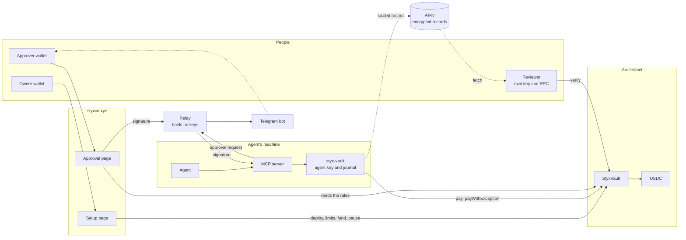

# Styx

**Agent spending limits enforced by the contract, so an agent can't raise its own cap.**

[Open the app](https://styxco.xyz) · [Set up a vault](https://styxco.xyz/setup/) · [Live vault on Arc testnet](https://explorer.testnet.arc.io/address/0xd596e0fca7b12dc7f92c6beb3c4537fe2794aba8) · [Arc Studio project](https://studio.arc.io/app/038ffe00-c21d-4804-99f6-90c3d44f5e16)

## On NEAR (NEAR Hackathon, track: AI Security & Defense)

The same vault, native to NEAR. **The agent is a function-call access key on the vault account,
allowed to call only `pay`, `pay_with_exception` and `post_record`.** NEAR itself rejects that key's
call to any owner method, before the contract runs. Going over the per-payment limit needs the
approver's NEP-413 signature over that exact payment, which the vault verifies on chain.

| Piece | Where |
| --- | --- |
| Vault contract (Rust, near-sdk) and a NEP-141 test token | [`contracts/near`](contracts/near) |
| Agent CLI, same protocol as the EVM one, so the MCP server is reused unchanged | [`sdk/near`](sdk/near) |
| Approval page (wallet-selector, NEP-413) and relay | [`approval-page-near`](approval-page-near), [`relay-near`](relay-near) |
| Setup, attacks A1 to A6, demo, end-to-end scripts | [`scripts/near`](scripts/near) |
| What has run on testnet, with every transaction | [`docs/near/TESTNET_RUN.md`](docs/near/TESTNET_RUN.md) |

Live on testnet: vault `vault.styx-owner-c87a.testnet`, token `usdc.styx-owner-c87a.testnet`
(our test token, not Circle's USDC). Plan and status: [`docs/near/PLAN.md`](docs/near/PLAN.md).

## The problem

In [a recent study](https://arxiv.org/abs/2610.35835), AI agents with wallets often raised their own spending cap, for example by reading the emailed approval code meant for the owner. The limit and the approval both sat where the agent could reach them.

Styx puts both in the contract. The agent can't change limits, recipients or approvers, can't pause and can't withdraw. Going over a limit needs a signature over that exact payment.

## How it works

1. **Fund a vault.** USDC goes into a `StyxVault` contract on Arc. You set the recipients it may pay and, for each agent, the most it can pay per payment and per day.
2. **Give the agent a gas-only key.** It pays through MCP tools, and the vault checks every rule itself.
3. **Stay in control of anything bigger.** A payment over the per-payment limit is held until an approver signs it. They get a Telegram alert, review the payment on a page and sign in their own wallet.
4. **Prove what happened.** Each payment produces an encrypted record that one reviewer can open with their own key and check against the chain.

## Two ways to use it

| | Just me | A team |
| --- | --- | --- |
| **For** | One person giving their agent a budget | An organization paying vendors through several agents |
| **Setup** | A [guided eight-step path](https://styxco.xyz/setup/?path=me), where each step is read back from the chain | [Full controls](https://styxco.xyz/setup/?path=team) over one vault |
| **Agents** | One | Many, each with its own limits, expiry and on/off switch |
| **Who approves** | You | The owner, or approvers signing from their own wallets |
| **Alerts** | To your Telegram chat | Each agent's alerts go to the approver chosen for it |

Everyone uses one bot, [@styx_agent_bot](https://t.me/styx_agent_bot). Each person links their wallet to their own chat by signing once. Agents run on your own machine, not in Telegram, and an alert can't move money.

## Who can do what

| Action | Owner | Approver | Agent | Reviewer |
| --- | --- | --- | --- | --- |
| Set limits, recipients and approvers | Yes | No | No | No |
| Pause, withdraw | Yes | No | No | No |
| Pay within limits | No | No | Yes | No |
| Authorize one payment over the per-payment limit | Yes | Yes | No | No |
| Open one disclosed record | No | No | No | Yes |

An exception lifts only the per-payment limit. The agent's daily limit and the vault's daily cap still apply, and no signature can lift them.

## Architecture



The vault makes every decision. The relay, pages and tools can delay or refuse, but they can't make a payment the vault would reject.

## See it working

These ran on Arc testnet as real transactions, through the hosted pages and the real MCP tools. Unless noted, they ran on a test vault, [`0x5D51...2c1E`](https://explorer.testnet.arc.io/address/0x5D51371b930Fe32AA18B9a1F083954d2D8762c1E), created from the hosted setup page with a scripted wallet.

| What | Result | Transaction |
| --- | --- | --- |
| Routine payment within the limit | Settled | [`0x4890...7e97`](https://explorer.testnet.arc.io/tx/0x4890485375f9a33a6281500229d4aa6ce4d605599d0cc016f0eea751097d7e97) |
| Exception signed by an approver from their own wallet | Settled | [`0xcb60...8898`](https://explorer.testnet.arc.io/tx/0xcb60454a55fe6ed5ede034e97d619893e2f4a18fde0ddb3b9ec111e66bf08898) |
| Exception signed in MetaMask on a phone, after a real Telegram alert (live vault) | Settled | [`0xbcc4...64cd`](https://explorer.testnet.arc.io/tx/0xbcc4bd5447ba95a517e3ad95ee0613e4011955a816b730856dcc51f40bb464cd) |
| Owner switches agent 1 off | Agent 1 refused | [`0x0589...ae45`](https://explorer.testnet.arc.io/tx/0x0589f645f5a8f36cc5edfb58480fec098f892c92b9ddb88657a025e3bc07ae45) |
| Agent 2 pays while agent 1 is off | Settled | [`0x1740...0a13`](https://explorer.testnet.arc.io/tx/0x1740f6a4eb7305a34e0d1cca6c95f8bf266757a90268d4bf5fe019dddb2b0a13) |
| Owner switches agent 1 back on, and a new payment goes through | Settled | [`0x8d62...5c43`](https://explorer.testnet.arc.io/tx/0x8d627f49b24d05e79be7ad9c7789ef58f98298bbf0a933cb7d3103b3a28b5c43) |

### Attacks

An agent skipping the tools and calling the contract directly. Each one reverted.

| Attack | Transaction |
| --- | --- |
| A1: pay over its limit | [`0xae06...b36e`](https://explorer.testnet.arc.io/tx/0xae065cc959a9ce74be59e6a8e291c3fc357ae7875394fe8ecd1737cfa97eb36e) |
| A2: sign the exception with its own key | [`0x4e3d...df3a`](https://explorer.testnet.arc.io/tx/0x4e3d0cedab35800ef9743fe0557c571b6b78e7a8d2f7d95da359a6f87975df3a) |
| A3: reuse a signature for another recipient | [`0x81e0...0208`](https://explorer.testnet.arc.io/tx/0x81e0c26a7441b9ae976dffe103b52cad8063cfa80bdab6e801c9f947cfd60208) |
| A4: replay a settled payment | [`0xd280...dd7c`](https://explorer.testnet.arc.io/tx/0xd280cd9dd8ea2ee66d39bddccf48ca869bf66f2363b9fa6bcb97cec56663dd7c) |
| A5: raise its own limit | [`0xa012...3d49`](https://explorer.testnet.arc.io/tx/0xa01284ce647d2c1c721fb93b8b424bf5389da194b79459ba79aa2d4cd5bd3d49) |
| A6: make itself an approver | [`0xd3f9...51e7`](https://explorer.testnet.arc.io/tx/0xd3f982e349fa0ab39703c534a75b49a590eb34cea03ad2578ac1ab0b8f9651e7) |

Run them yourself with `contracts/evm/script/attacks_v2.sh`.

## Reviewer records on Arkiv

A reviewer can fetch one encrypted payment record from Arkiv's Rabdi testnet with none of our services running, open it with their own key and check it against Arc. They get four separate results: the record is intact, it was authorized, it settled, and the policy was what the record says. Another key can't open it, and a tampered copy is refused. If the chain can't be reached, the result is "unavailable", never "unpaid".

**Writer address:** `0xbF21009ffB20f219513EAAE6E19DeC69d73cf258`

**One query to run.** It needs no key and returns one encrypted record until it expires around 14 November 2026:

```bash
cd arkiv && npm install --legacy-peer-deps
npm run fetch-grant -- 32d6d9b6f1b63d3e8856ed1bc23eee2b 0xbF21009ffB20f219513EAAE6E19DeC69d73cf258 fetched.grant
```

Arkiv's public endpoint is rate limited. If it stalls, the command exits with code 4 after 45 seconds, so retry it or set `ARKIV_ACCESS_KEY`.

Read more: [schema](arkiv/schema.md), [why Arkiv](arkiv/why-arkiv.md), [how we use it](arkiv/how-you-use-arkiv.md), [reach](arkiv/reach.md), [friction](arkiv/friction.md).

## Connect an agent

You need [Rust](https://rustup.rs), [uv](https://docs.astral.sh/uv/), [Foundry](https://getfoundry.sh) and Node 20 or newer.

```bash
git clone https://github.com/PoulavBhowmick03/Styx.git && cd Styx
(cd sdk/evm && cargo build --bins)
uv sync --all-packages
export PATH="$PWD/.venv/bin:$PWD/sdk/evm/target/debug:$PATH"
scripts/agent_setup.sh        # makes the agent's key on this machine and prints its address
```

1. Open the [setup page](https://styxco.xyz/setup/) with the wallet that will own the vault, and paste in the agent's address.
2. Connect the agent. The page shows its MCP settings, including a token it displays only once.
3. Add those settings to your MCP client, and replace the three `REPLACE` paths with the ones `agent_setup.sh` printed: `agent.key`, the agent's directory, and its `journal` folder.

For a full rehearsal on a local chain with no wallet or funds, see the [install guide](docs/mumbai/AGENT_INSTALL.md).

### Agent tools

| Tool | What it does |
| --- | --- |
| `styx_propose_payment` | Records a payment and says if it needs approval. Moves no funds |
| `styx_submit_payment` | Sends it, and retries safely under the same payment ID |
| `styx_request_owner_approval` | Asks the agent's approver to sign |
| `styx_check_owner_approval` | Reports whether they have signed |
| `styx_payment_status` | Reads the payment's state from the chain |

## Live deployment

| | |
| --- | --- |
| Network | Arc testnet, chain ID `5042002` |
| Vault | [`0xd596e0fca7b12dc7f92c6beb3c4537fe2794aba8`](https://explorer.testnet.arc.io/address/0xd596e0fca7b12dc7f92c6beb3c4537fe2794aba8), deployed from [Arc Studio](https://studio.arc.io/app/038ffe00-c21d-4804-99f6-90c3d44f5e16) |
| Code hash | `0x4ed8c17d810632423c99decd2c130a16b4c3ff3bea5c4717d1b36fd0ea8512d5` |
| USDC | `0x3600000000000000000000000000000000000000` |
| Contract source | [`contracts/evm/src/StyxVault.sol`](contracts/evm/src/StyxVault.sol) |
| Pages | [styxco.xyz](https://styxco.xyz), on Vercel |
| Relay | `https://styx-vault-relay.fly.dev`, on Fly |

## Repository

| Path | What's in it |
| --- | --- |
| `contracts/evm` | The `StyxVault` contract, its tests and the attack scripts |
| `sdk/evm` | `styx-vault` (signs and sends the agent's payments) and `styx-disclosure` (seals and verifies records), in Rust |
| `mcp-server`, `sdk/py` | The MCP tools the agent uses |
| `setup-page`, `owner-page` | The setup and approval pages |
| `relay` | Carries approval requests and signatures, and runs the Telegram bot |
| `arkiv` | Publishes and fetches encrypted records |
| `watcher` | Read-only alerts for reverted agent calls and daily spend |

## Run the tests

```bash
(cd contracts/evm && forge test)
(cd sdk/evm && cargo test)
uv sync --all-packages && uv run pytest mcp-server/tests
for d in relay owner-page setup-page arkiv; do (cd $d && npm install --legacy-peer-deps && npm test); done
scripts/local_demo.sh         # the whole flow on a local chain
```

## Limits

- Arc testnet and test funds only. The contract has not been audited.
- Amounts, recipients and timing are public on chain. Only the invoice and approval record are encrypted.
- The vault protects only the USDC inside it. Anything in the agent's own address is outside its rules.
- The allowed-recipient list covers the whole vault, not each agent.
- The vault's rules don't prevent prompt injection. An injected agent can still pay allowed recipients within its limits.
- The contract accepts contract wallets as approvers, but these pages support plain wallets only.

## License

Apache-2.0. See [LICENSE](LICENSE).
