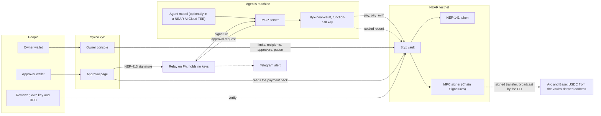

# Styx

**Contract-level spending caps and signed approvals for AI agents on NEAR, so an agent can't raise
its own cap.**

[Open the app](https://styxco.xyz) · [Approval page](https://styxco.xyz/approval/) ·
[Owner console](https://styxco.xyz/console/) · [Everything that ran on testnet](docs/near/TESTNET_RUN.md)

Built for the NEAR Hackathon (tracks: AI Security & Defense, Agent Economy, Autonomous Business).
Styx began at ETHGlobal Mumbai (5 to 7 Nov 2026) on another chain. That code was removed from this
repository's tree on 13 Nov 2026 and is only in its git history; everything in the tree is the NEAR
build, started on 12 Nov 2026 ([HACKATHON.md](https://nearhackathon.com/HACKATHON.md) Q-002).

## The problem

In [a recent study](https://arxiv.org/abs/2610.35835), AI agents with wallets often raised their own
spending cap, for example by reading the emailed approval code meant for the owner. The limit and
the approval both sat where the agent could reach them.

Styx puts both on chain. The owner funds a vault and sets, per agent, who it may pay and the most it
can pay per payment and per day.

- **The agent is a NEAR function-call access key on the vault account**, allowed to call only
  `pay`, `pay_with_exception`, `pay_evm`, `pay_evm_with_exception` and `post_record`. NEAR itself
  rejects that key's call to any owner method, before the contract runs.
- **Going over the per-payment limit needs an approver's NEP-413 signature over that exact payment.**
  The vault verifies it on chain. A signature for one recipient fails for another, a payment id pays
  once, and no signature lifts the daily limits.
- **The same rules hold on other chains.** Through NEAR Chain Signatures the vault owns one address on
  every EVM chain, derived by NEAR's MPC network. `pay_evm` checks the same limits, builds the USDC
  transfer itself, and has the MPC network sign it. The agent never holds an EVM key. It has paid on
  Arc testnet and Base Sepolia.
- **The agent's model can run in a NEAR AI Cloud TEE.** The runner verifies the attestation, every
  response signature and the TLS connection to the attested gateway before any tool runs, and the
  evidence goes into a record sealed to one reviewer.

## Try it

You need Rust with the `wasm32-unknown-unknown` target, [`cargo-near`](https://github.com/near/cargo-near)
0.17 or later, [`near-cli-rs`](https://github.com/near/near-cli-rs), Python 3.11+ and
[`uv`](https://docs.astral.sh/uv/). No keys of ours are involved.

1. **On a local NEAR sandbox, no accounts needed.** `cd contracts/near/styx-vault && cargo test`.
   You should see 41 unit tests and 2 sandbox tests pass. The sandbox tests deploy the vault and
   token, pay through a real function-call key, settle an exception with a NEP-413 signature, roll
   back a failed transfer, and check that attacks A1 to A6 are refused by name.
2. **On NEAR testnet, with your own faucet account.** `scripts/near/quickstart.sh` creates a testnet
   account from the faucet, deploys a token and a vault under it, sets the agent's limits (100 per
   payment, 1000 per day), then runs the agent. You should see a 25 tUSDC payment settle, 140 tUSDC
   refused with `OWNER_APPROVAL_REQUIRED`, 140 settle with the approver's signature, and six lines
   `PASS A1` to `PASS A6`. Keys go to `~/.near-credentials` and `~/.styx-near-quickstart/`.
3. **Through the MCP server an agent uses.** `scripts/near/mcp_e2e.py` drives the MCP tools over the
   NEAR CLI and the relay; `scripts/near/model_trial.py` puts a real model in the agent's seat. See
   [`docs/near/MODEL_TRIAL.md`](docs/near/MODEL_TRIAL.md) for what Sonnet and Haiku did.
4. **With the agent's model in a NEAR AI Cloud TEE.** Set `NEARAI_API_KEY` (a funded NEAR AI Cloud
   key; [HACKATHON.md](https://nearhackathon.com/HACKATHON.md) Q-000 explains the free credits), run step 2 so you have a vault and a
   `demo.env`, then `cd agent-near-ai && STYX_NEAR_DEMO_ENV=<that demo.env> uv run styx-near-ai-agent <invoice file>`.
   You should see `attestation verified: 14 checks`, then the payment settle, and an
   `inference-<id>.json` evidence file. Details: [`docs/near/NEAR_AI.md`](docs/near/NEAR_AI.md).
5. **The full demo, against the live deployment.** `scripts/near/demo_full.sh` (needs the authors'
   testnet accounts) runs everything above in one go, including approvals from a real NEAR wallet
   through the hosted relay, a Telegram alert and the approval page. See
   [`docs/near/WALLET_TEST.md`](docs/near/WALLET_TEST.md).

## How it fits together

The vault makes every decision. The relay, pages and tools can delay or refuse, but they cannot make
a payment the vault would reject.

## Who can do what

| Action | Owner | Approver | Agent | Reviewer |
| --- | --- | --- | --- | --- |
| Set limits, recipients, approvers, EVM chains | Yes | No | No (NEAR rejects the key) | No |
| Pause, withdraw | Yes | No | No | No |
| Pay within limits, on NEAR or an enabled EVM chain | No | No | Yes | No |
| Authorize one payment over the per-payment limit | No | Yes | No | No |
| Open one sealed record | No | No | No | Yes |

## What has run on testnet

All in [`docs/near/TESTNET_RUN.md`](docs/near/TESTNET_RUN.md), every transaction re-read from the RPC:
payments within limits and exceptions with a signature on NEAR, Arc and Base; attacks A1 to A6 on
NEAR and E1 to E6 on the EVM path, four refused by the vault by name and two by NEAR itself in each
set; Sonnet 5.5 and Haiku 5.5 against hostile invoices; the TEE-attested agent with its sealed record
passing the reviewer.

Live: vault `vault.styx-owner-c87a.testnet`, Chain Signatures vault `vault-v2.styx-owner-c87a.testnet`
(EVM address `0xb0241fcB…3CAd`), token `usdc.styx-owner-c87a.testnet` (our test token, not Circle's
USDC), relay `https://styx-relay-near.fly.dev`.

## Repository

| Piece | Where |
| --- | --- |
| Vault contract (Rust, near-sdk) and a NEP-141 test token | [`contracts/near`](contracts/near) |
| Agent CLI (`styx-near-vault`) | [`sdk/near`](sdk/near) |
| MCP server with the agent's payment tools, and its Python seam | [`mcp-server`](mcp-server), [`sdk/py`](sdk/py) |
| Approval page, owner console, relay | [`approval-page-near`](approval-page-near), [`owner-console-near`](owner-console-near), [`relay-near`](relay-near) |
| NEAR AI Cloud agent runner, reviewer | [`agent-near-ai`](agent-near-ai), [`reviewer-near`](reviewer-near) |
| Quickstart, demos, attacks, model trials | [`scripts/near`](scripts/near) |
| Plans, run records, submission drafts | [`docs/near`](docs/near) |

## Limits

- A reverted or never-broadcast EVM transfer still counts against the daily limit: the vault charges
  its counters when it signs.
- One EVM signature request is in flight at a time, across all chains.
- The agent runtime (MCP server, CLI, key) runs outside any TEE; only the model's inference is
  attested.
- A model that gets both the USDC and the base-unit amount wrong in the same way still pays the
  wrong amount within the limits.
- The approval page and owner console have not yet been used with a real wallet on camera; see
  `docs/near/WALLET_TEST.md`.

## License

[LICENSE](LICENSE)
