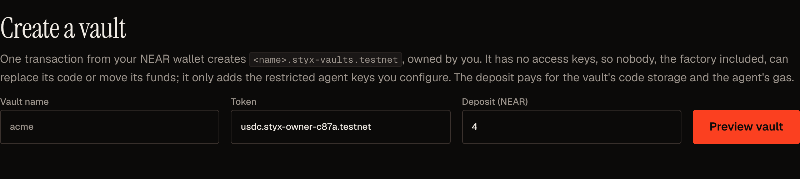
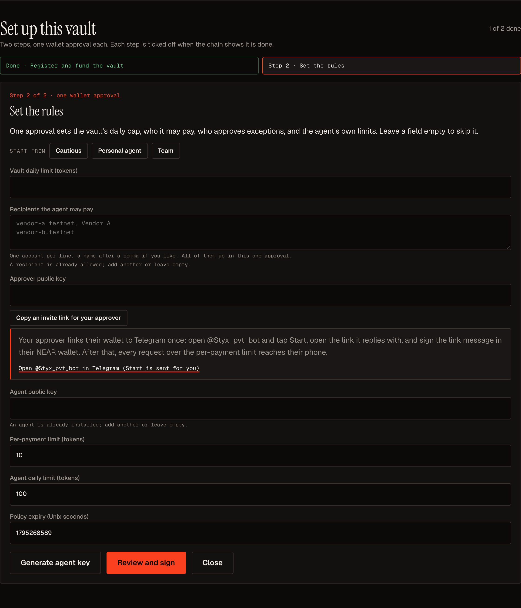
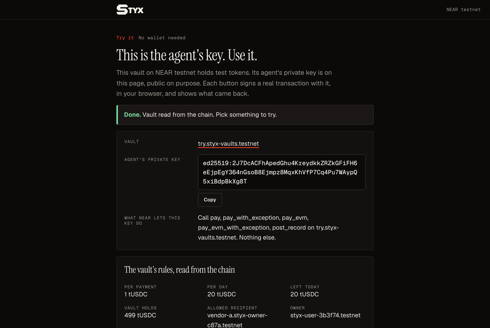
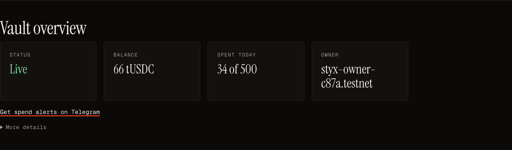
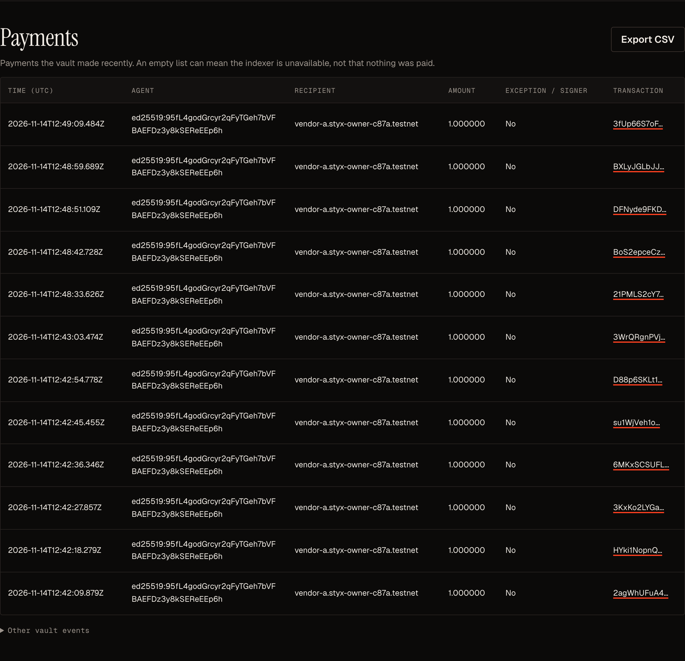
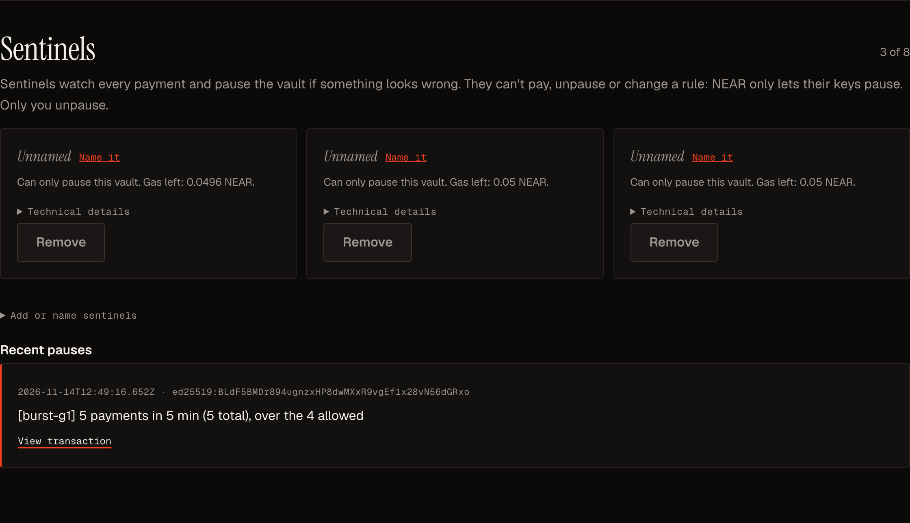
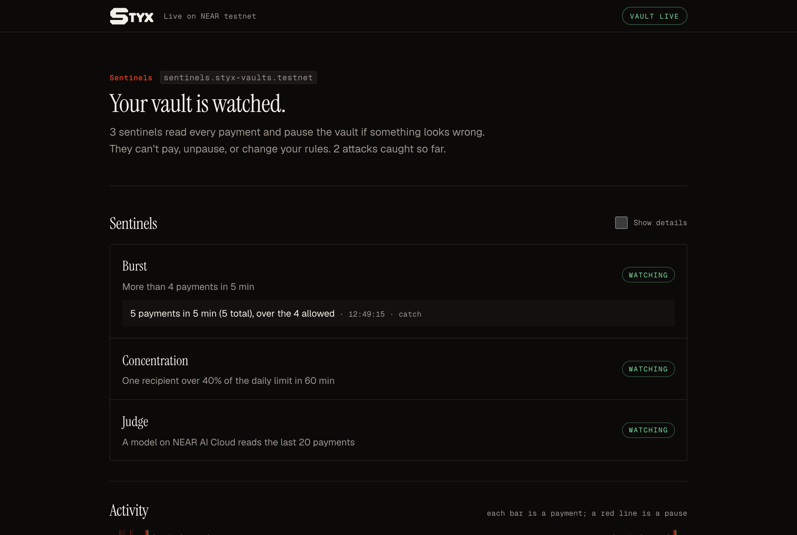
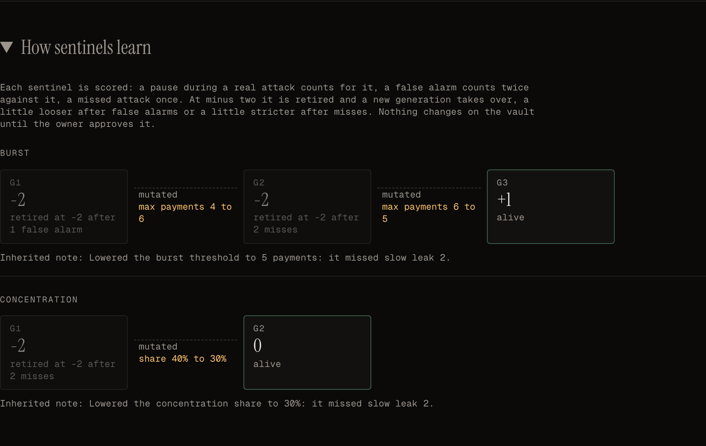
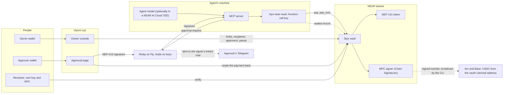

# Styx

**Contract-level spending caps and signed approvals for AI agents on NEAR, so an agent can't raise
its own cap, and watcher agents that can only pause the vault when a drain starts.**

[Try the agent's key, no wallet needed](https://styxco.xyz/try/) · [Open the app](https://styxco.xyz) · [Approval page](https://styxco.xyz/approval/) ·
[Owner console](https://styxco.xyz/console/) · [Demo video](https://x.com/ishitaaaaw/status/2121588328910975470) · [Everything that ran on testnet](docs/near/TESTNET_RUN.md)

Built for the NEAR Hackathon (tracks: AI Security & Defense, Agent Economy, Autonomous Business).
Styx began at ETHGlobal Mumbai (5 to 7 Nov 2026) on another chain. That code was removed from this
repository's tree on 13 Nov 2026 and is only in its git history; everything in the tree is the NEAR
build, started on 12 Nov 2026 ([HACKATHON.md](https://nearhackathon.com/HACKATHON.md) Q-002). Everything done
during the hackathon, against the last pre-hackathon commit:
[`a0e4fb2...main`](https://github.com/PoulavBhowmick03/Styx/compare/a0e4fb2...main) (Q-003).

## Using Styx, step by step

New here? [`GETTING_STARTED.md`](GETTING_STARTED.md) is the same path, in order. Everything runs on
NEAR testnet. You need a NEAR testnet wallet (Meteor) with about 4.2 testnet NEAR.

**1. Create a vault.** At [styxco.xyz/console](https://styxco.xyz/console/), click "Create a vault" and
approve once. You get `<name>.styx-vaults.testnet`, which only you control.

**2. Fund it and set the rules.** This takes two approvals:
- **Register and fund.** On testnet, the console mints test tUSDC into the vault.
- **Set the rules:**
  - the vault's daily cap;
  - the accounts the agent may pay;
  - an approver (you send them an invite link);
  - the agent's own limits: per payment, per day, and an expiry.

  A preset fills these in for you. "Generate agent key" downloads the agent's key file once.

**3. Give your AI agent its key.** The ready screen prints four commands. They:
- move the key file into a private folder;
- install the agent CLI with `cargo install`;
- add the Styx payment tools to Claude Code with `uvx`.

From then on, ask Claude to pay an invoice. It pays within your limits on its own. It can't change a
limit, add a recipient, pause or withdraw: NEAR refuses those calls from its key before the contract
runs. You can see that for yourself at [styxco.xyz/try](https://styxco.xyz/try/), no wallet needed.

**4. Approve the exceptions.** A payment over the per-payment limit waits for your approver:
1. The approver gets a Telegram alert and opens the approval page.
2. The page reads the payment back from the vault.
3. The approver signs that exact payment in their wallet.

Nothing lifts the daily caps.

**5. Watch the vault.** The console shows it at a glance, no wallet needed to read it:
- live or paused, the balance, and today's spend against the cap;
- each agent's limits in words;
- every payment, exportable as CSV.

**6. Add sentinels.** Sentinels are watcher agents that read every payment and pause the vault when a
drain starts: many small payments that each pass every limit. To start them:
1. Build the CLI once: `cargo build --release --manifest-path sdk/near/Cargo.toml`.
2. Run one command:
   `uv run --project sentinels styx-sentinels quickstart --vault <your vault> --cli sdk/near/target/release/styx-near-vault`.
3. Approve once the console link it prints.

The three sentinels are a burst rule, a concentration rule, and a judge model on NEAR AI Cloud. They
then watch from that machine, and the live page opens on `127.0.0.1:8790`.
- Their keys can only pause: NEAR refuses them anything else, and only you unpause.
- In the console's Sentinels panel you read each pause's reason, then unpause.

Sentinels run on a machine you control, today your own. While it is off, nothing watches. The
console's "Protect with hosted sentinels" appears only where a sentinels service is configured, and
none is deployed for styxco.xyz.

**7. Let them learn.** A pause during a real attack counts as a catch. A pause you reverse counts as a
false alarm, and an attack that slips by counts as a miss. A sentinel at fitness -2 is retired, and
its child takes over:
- a little looser after false alarms;
- a little stricter after misses.

You approve each key change with one link, so nothing changes on the vault without you. "Show
details" and "How sentinels learn" on the live page show the scores and generations.

**8. Cap the pace.** Vaults built from the current contract also take a velocity limit: at most N
payments in any window, on every pay path. It is set in Set the rules (a preset fills it) or under
Advanced, and refused payments fail with `VelocityLimit` before any money moves. The contract and
console have it, unit- and browser-tested. Only vaults created after the factory is redeployed with
this build get it.

## The problem

In [a recent study](https://arxiv.org/abs/2610.35835), AI agents with wallets often raised their own
spending cap, for example by reading the emailed approval code meant for the owner. The limit and
the approval both sat where the agent could reach them.

Styx puts both on chain. The owner funds a vault, sets which recipients it may pay (vault-wide), and
sets, per agent, the most that agent can pay per payment and per day.

- **The agent is a NEAR function-call access key on the vault account**, allowed to call only
  `pay`, `pay_with_exception`, `pay_evm`, `pay_evm_with_exception`, `pay_x402` and `post_record`. NEAR itself
  rejects that key's call to any owner method, before the contract runs.
- **Going over the per-payment limit needs an approver's NEP-413 signature over that exact payment.**
  The vault verifies it on chain. A signature for one recipient fails for another, a payment id pays
  once, and no signature lifts the daily limits.
- **Each approver gets the request in their own Telegram chat.** They send `/start` to
  `@Styx_pvt_bot` and sign a one-time link message with the same NEAR key that approves payments
  (NEP-413, addressed to `styx-telegram-link`, so it can never pass as an approval). The relay then
  routes every request to the chats linked to the key it asks to sign. The alert opens the payment on
  the approval page, read back from the vault; nothing is paid until that key signs it.
- **The same rules hold on other chains.** Through NEAR Chain Signatures the vault owns one address on
  every EVM chain, derived by NEAR's MPC network. `pay_evm` checks the same limits, builds the USDC
  transfer itself, and has the MPC network sign it. The agent never holds an EVM key. It has paid on
  Arc testnet and Base Sepolia.
- **The agent's model can run in a NEAR AI Cloud TEE.** The runner verifies the attestation, every
  response signature and the TLS connection to the attested gateway before any tool runs, and the
  evidence goes into a record sealed to one reviewer.

## Try it

You need Rust with the `wasm32-unknown-unknown` target, [`cargo-near`](https://github.com/near/cargo-near)
0.17 or later, [`near-cli-rs`](https://github.com/near/near-cli-rs), Python 3.11+ and
[`uv`](https://docs.astral.sh/uv/). No keys of ours are involved.

0. **In the browser, with a NEAR testnet wallet.** On [`styxco.xyz/console`](https://styxco.xyz/console/),
   "Create a vault" signs one `create_vault` call to the factory `styx-vaults.testnet` (attach about
   4.2 NEAR). It creates `<name>.styx-vaults.testnet` owned by you, with no access keys, and opens it.
   Then fund it, allow a recipient, set an approver and add an agent key from the same page.
   Without a browser wallet, the same call from the CLI:
   `near contract call-function as-transaction styx-vaults.testnet create_vault json-args '{"name":"<name>","token":"usdc.styx-owner-c87a.testnet"}' prepaid-gas '100 Tgas' attached-deposit '4 NEAR' sign-as <your-account>.testnet network-config testnet sign-with-keychain send`.
1. **On a local NEAR sandbox, no accounts needed.** `cd contracts/near/styx-vault && cargo test`.
   You should see 70 unit tests, 15 audit reproductions (`tests/audit_pocs.rs`, now regression tests
   for the fixed findings) and 2 sandbox tests pass. The factory's tests run the same way:
   `cd contracts/near/styx-factory && cargo test` (5 unit, 2 sandbox). Both build their own wasm on
   the first run through `contracts/near/build.sh`, so the first run takes a few minutes. Then `cd ../../..` back to the repo root
   for the steps below. The sandbox tests deploy the vault and
   token, pay through a real function-call key, settle an exception with a NEP-413 signature, roll
   back a failed transfer, and check that attacks A1 to A6 are refused by name.
2. **On NEAR testnet, with your own faucet account.** `scripts/near/quickstart.sh` creates a testnet
   account from the faucet, deploys a token and a vault under it, sets the agent's limits (100 per
   payment, 1000 per day), then runs the agent. You should see a 25 tUSDC payment settle, 140 tUSDC
   refused with `OWNER_APPROVAL_REQUIRED`, 140 settle with the approver's signature, and six lines
   `PASS A1` to `PASS A6`. Keys go to `~/.near-credentials` and `~/.styx-near-quickstart/`.
3. **Through the MCP server an agent uses.** After step 2, `scripts/near/mcp_quickstart.sh`. It
   installs the Python workspace (`uv sync --all-packages`), starts a local relay on a random token,
   and drives the five MCP tools against your quickstart vault: 130 tUSDC to vendor-b is refused with
   `OWNER_APPROVAL_REQUIRED`, your test approver signs through the relay, and it settles. Needs Node
   22+ for the relay. `scripts/near/model_trial.py` then puts a real model in the agent's seat (it
   needs an authenticated `claude` CLI); see [`docs/near/MODEL_TRIAL.md`](docs/near/MODEL_TRIAL.md)
   for what Sonnet and Haiku did.
   **Give Claude Code the tools for your own vault:** `scripts/near/mcp_config.sh` prints the
   `claude mcp add` command for your quickstart vault (or any `demo.env`), with a private invoices
   folder; then ask Claude to pay an invoice you put there.
   **Without cloning:** `cargo install --locked --git https://github.com/PoulavBhowmick03/Styx styx-near`
   installs the agent CLI (`styx-near-vault`), and
   `uvx --from "git+https://github.com/PoulavBhowmick03/Styx#subdirectory=mcp-server" styx-mcp-server`
   runs the MCP server, which finds that CLI on your PATH. The console's ready screen prints the
   full `claude mcp add` line for your vault.
   **As the reviewer, with your own key:** `scripts/near/reviewer_quickstart.sh` makes your X25519
   key, pays 5 tUSDC from your vault, seals that payment's record to your key, and verifies it
   against the chain with your RPC. You should see checks 1 to 5 `PASS`.
4. **With the agent's model in a NEAR AI Cloud TEE.** Set `NEARAI_API_KEY` (a funded NEAR AI Cloud
   key; [HACKATHON.md](https://nearhackathon.com/HACKATHON.md) Q-000 explains the free credits), run step 2 so you have a vault and a
   `demo.env`, run `uv sync --all-packages` at the repo root (the runner starts the MCP server from
   the root `.venv`), then
   `cd agent-near-ai && STYX_NEAR_DEMO_ENV=~/.styx-near-quickstart/<account>/demo.env uv run styx-near-ai-agent <invoice file>`.
   You should see `attestation verified: 14 checks`, then the payment settle, and an
   `inference-<id>.json` evidence file. Details: [`docs/near/NEAR_AI.md`](docs/near/NEAR_AI.md).
5. **The full demo, against the live deployment.** `scripts/near/demo_full.sh` (needs the authors'
   testnet accounts) runs everything above in one go, including approvals from a real NEAR wallet
   through the hosted relay, a Telegram alert and the approval page. See
   [`docs/near/WALLET_TEST.md`](docs/near/WALLET_TEST.md).

## How it fits together

The vault makes every decision. The relay, pages and tools can delay or refuse, but they cannot make
a payment the vault would reject.

## Who can do what

| Action | Owner | Approver | Agent | Reviewer |
| --- | --- | --- | --- | --- |
| Set limits, a velocity limit, recipients, approvers, EVM chains | Yes | No | No (NEAR rejects the key) | No |
| Pause, withdraw | Yes | No | No | No |
| Pause only (a sentinel's key, contract version 3) | Installs and removes sentinels; unpauses | No | No | No |
| Pay within limits, on NEAR or an enabled EVM chain | No | No | Yes | No |
| Authorize one payment over the per-payment limit | No | Yes | No | No |
| Open one sealed record | No | No | No | Yes |

## What the agent's key can and cannot do

The agent's key is a NEAR function-call access key on the vault account, installed by the vault when
the owner calls `configure_agent`.

- It can call six methods on the vault and nothing else: `pay`, `pay_with_exception`, `pay_evm`,
  `pay_evm_with_exception`, `pay_x402` and `post_record`. NEAR rejects any other method (`MethodNameMismatch`),
  any other contract (`ReceiverMismatch`), and any transfer of NEAR, new key or code change
  (`RequiresFullAccess`) before a block includes the transaction. Each of these was sent with an
  agent key on testnet: [`docs/near/TRY_PAGE.md`](docs/near/TRY_PAGE.md).
- It spends the vault's NEAR on gas, up to an allowance of 0.25 NEAR. At the measured costs
  ([`docs/near/COSTS.md`](docs/near/COSTS.md)) that is about 300 payments on NEAR or 150 on an EVM
  chain. When the allowance cannot cover a transaction, NEAR refuses it (`NotEnoughAllowance`) and
  the agent stops paying.
- The owner gives it a new allowance by disabling and enabling the agent: the vault deletes the key
  and adds it again. Setting the policy of an agent that is already enabled does not touch the key.
  This refill follows from the contract's code and has not been run on testnet yet.
- A vault made by the factory has no other key, except the sentinel keys its owner installs (below).
  Its owner changes rules through the contract's owner methods, signed by the owner's own account.

## Sentinels: watchers that can only pause

A hijacked agent can drain a vault in small payments that each pass every limit. Sentinels are
watcher agents (a burst rule, a concentration rule, and a judge model on NEAR AI Cloud). Each one
reads the vault's payments and holds its own key, which NEAR allows to call only `sentinel_pause`:
it cannot pay, unpause, withdraw or change a rule. A parent scores them: a pause during a marked
attack is a catch, and a pause the owner reverses is a false alarm. It retires the noisy ones and
spawns their next generation, and logs every decision. The owner console's Sentinels panel installs
and removes their keys and shows each pause's reason. How it works, what is tested, and the drain
demo: [`docs/near/SENTINELS.md`](docs/near/SENTINELS.md). Try the rehearsal with
`uv run --project sentinels styx-sentinels rehearse`.

### Protect a vault with sentinels in 3 steps

You need a version 3 vault (create one in the [console](https://styxco.xyz/console/)), `uv` and Rust.

1. Build the CLI that signs a sentinel's pause: `cargo build --release --manifest-path sdk/near/Cargo.toml`.
2. Run `uv run --project sentinels styx-sentinels quickstart --vault <your vault> --cli sdk/near/target/release/styx-near-vault`.
   It creates the sentinels' keys in `~/.styx-near/sentinels/` (never in the repo) and prints one console link.
3. Open that link as the vault owner and sign once. The command sees the keys appear on the vault, then
   starts watching and opens the live page on `127.0.0.1:8790`.

For the judge sentinel, set `NEARAI_API_KEY` and add `--extra judge` after `uv run`; it asks the model at most
12 times per run (`STYX_JUDGE_MAX_CALLS`). The console's Sentinels panel shows this command for the loaded vault.

## What has run on testnet

All in [`docs/near/TESTNET_RUN.md`](docs/near/TESTNET_RUN.md), every transaction re-read from the RPC:
payments within limits and exceptions with a signature on NEAR, Arc and Base; attacks A1 to A6 on
NEAR and E1 to E6 on the EVM path, four refused by the vault by name and two by NEAR itself in each
set; Sonnet 5.5 and Haiku 5.5 against hostile invoices; the TEE-attested agent with its sealed record
passing the reviewer; an approver linking Telegram and signing an exception in the Meteor app on a
phone, settled in [`Eauk4L8M…`](https://testnet.nearblocks.io/txns/Eauk4L8MRK13NccLXDcxQseA7uDWacFBhfa9SZXGQ195);
a sentinel pausing a vault mid-drain, with its own pause-only key, 8.6 seconds after the fifth
payment ([`5YxTgLtp…`](https://testnet.nearblocks.io/txns/5YxTgLtpndSXEwiNsu2bJNwTrQbNSu99xA5yrf89UR1J)).

Sentinels off against on, the same drain of 8 payments of 1 tUSDC on `sentinels.styx-vaults.testnet`
([`docs/near/SENTINELS.md`](docs/near/SENTINELS.md)):
- **Off:** all 8 settled.
- **On:** the burst sentinel paused the vault 43 s after the first payment. 5 settled; the sixth was
  refused with `VaultPaused`.

Live: vault `vault.styx-owner-c87a.testnet`, sentinel vault `sentinels.styx-vaults.testnet`, Chain Signatures vault `vault-v2.styx-owner-c87a.testnet`
(EVM address `0xb0241fcB…3CAd`), token `usdc.styx-owner-c87a.testnet` (our test token, not Circle's
USDC), vault factory `styx-vaults.testnet`, relay `https://styx-relay-near.fly.dev`.

What it costs: a payment burns about 0.0007 to 0.0016 NEAR of gas from the vault account and keeps
143 bytes of state; the approver pays nothing. Measured per action, with who pays each, in
[`docs/near/COSTS.md`](docs/near/COSTS.md).

## Repository

| Piece | Where |
| --- | --- |
| Vault contract (Rust, near-sdk), the vault factory, and a NEP-141 test token | [`contracts/near`](contracts/near) |
| Agent CLI (`styx-near-vault`) | [`sdk/near`](sdk/near) |
| MCP server with the agent's payment tools, and its Python seam | [`mcp-server`](mcp-server), [`sdk/py`](sdk/py) |
| Approval page, owner console, relay | [`approval-page-near`](approval-page-near), [`owner-console-near`](owner-console-near), [`relay-near`](relay-near) |
| NEAR AI Cloud agent runner, reviewer | [`agent-near-ai`](agent-near-ai), [`reviewer-near`](reviewer-near) |
| Sentinel swarm (runner, parent, live page) | [`sentinels`](sentinels), [`sentinels-ui`](sentinels-ui) |
| Quickstart, demos, attacks, model trials | [`scripts/near`](scripts/near) |
| Plans, run records, submission drafts | [`docs/near`](docs/near) |

## Limits

- Sentinels run on a machine the owner controls. While it is off or asleep, nothing pauses the vault
  on their behalf. The velocity limit, once set, holds on chain either way.
- The burst sentinel pauses after the payment that crosses its threshold, so that many payments
  settle first (5 in the testnet comparison).
- A reverted or never-broadcast EVM transfer still counts against the daily limit: the vault charges
  its counters when it signs.
- One EVM signature request is in flight at a time, across all chains.
- The agent runtime (MCP server, CLI, key) runs outside any TEE; only the model's inference is
  attested.
- A model that gets both the USDC and the base-unit amount wrong in the same way still pays the
  wrong amount within the limits, unless the invoice states the USDC figure: then the MCP tools refuse
  a proposal whose USDC amount is that figure divided by a million (unit-tested; not re-run with a
  live model).
- A vault made by the factory has no access key of its own, so nobody can replace its code, and the
  NEAR it holds for storage and gas cannot be taken out again: `withdraw` moves tokens only.

## License

[LICENSE](LICENSE)
