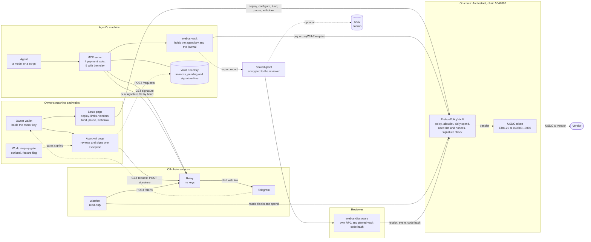
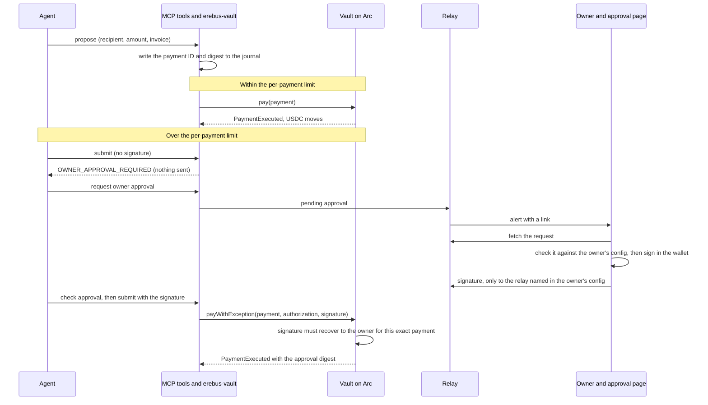

# Architecture

How the parts fit together, what each one is trusted for, and what lives on the chain. It describes what is on `main`, and every part is labelled with what has actually been run. Nothing here is audited, and nothing is described as private except what is encrypted.

## The picture

Solid arrows are calls that exist in the code. Dotted arrows are optional, done by hand, or not yet run live. The last column of the table below says what has actually been run, and where.

## An ordinary payment and an exception

The vault runs every check itself. The tools, the relay and the pages can refuse, delay or mislead, but none of them can make a payment the vault would refuse.

## The parts

| Part | What it is | Holds | Trusted for | Not trusted for, and what a compromise can do | Run so far |
| --- | --- | --- | --- | --- | --- |
| **Owner** | A person with a wallet, in their own browser profile | The owner key, only in the wallet | Setting the rules, funding, signing exceptions, pausing, withdrawing | If the owner key is lost or stolen, the thief is the owner: the vault has no recovery and no way to change owner | A real MetaMask account signed an exception on Arc |
| **Vault contract** (`contracts/evm/src/ErebusPolicyVault.sol`) | One vault per owner and agent. Immutable owner and token, not upgradeable | USDC, the policy, the allowlist, spend per day, used payment IDs and nonces | Enforcing every limit, the allowlist, expiry, replay protection, and that an exception is signed by the owner over the exact payment | It trusts the token to be a plain ERC-20, and the owner to be a plain account (no smart-contract wallets). It does not check World. It does not cap a total across split payments beyond the daily limit | Deployed on Arc from Arc Studio. A real routine payment and an owner-signed exception settled, and A1 to A4 reverted. Not audited |
| **USDC token** | Arc's ERC-20 view of native USDC, 6 decimals. The same balance is the native gas balance, with 18 decimals | The balances | Moving money when the vault calls `transfer` | The vault rejects any transfer that does not change the recipient's balance by exactly the amount | Used in the live run |
| **Setup page** (`setup-page/`) | A static page: deploy or connect a vault, set limits, vendors, fund, pause, withdraw | Nothing. It never asks for a key | Showing the connected vault, warning before a second deploy, reading policy from the chain | A page cannot be trusted to be the right one: the owner checks the vault address in its banner and the wallet's own prompt. It cannot move the agent's money | Browser tests on a local chain. An owner used an earlier version with MetaMask on Arc and hit four problems; the fixes have been tested on a local chain only, not re-tried with a real wallet |
| **Approval page** (`owner-page/`) | A static page: loads one request, checks it against the owner's own config, and signs the exact payment | Nothing | Showing the recipient, amount and expiry, with vendor names only from the owner's config and the limit read from the chain. Agent text is shown as text | The agent's text and the relay are not trusted: the page re-checks everything, and the vault re-checks the signature | Browser tests, and a real MetaMask signature on Arc |
| **World step-up gate** (optional) | A feature-flagged step in front of signing, with a small backend | A World client secret, in its own server | Nothing on-chain. It only decides whether the sign button appears | The contract never checks it. World's proofs at this event are mocked | Local tests with a fake identity provider. **Not run with World** |
| **Agent** | A model or a script | Nothing but what its tools give it | Proposing and submitting payments | It is not trusted: it can be fooled by invoice text. It cannot change policy, sign an exception or withdraw. It holds only a gas-only key | A real model was run on a local chain (`mcp-server/examples/MODEL_TRIAL.md`) |
| **MCP server** (`mcp-server/src/erebus_mcp/vault.py`) | Four tools: propose, submit, status and request approval, plus check approval when a relay is configured | Paths to files, and the relay token | Passing requests to `erebus-vault` and returning structured errors | It makes no policy decision. It refuses to start if an owner key variable is set, but cannot see a key under another name | Tests, a local chain, and the live Arc run |
| **`erebus-vault`** (`sdk/evm/src/arc_vault/`) | The only program that signs and sends the agent's transactions | The agent key file and the journal | Writing the payment ID and digest to disk before it submits, and retrying under the same ID | It sends only what the vault will accept: a bug here could send wrong data but not bypass a rule | Tests, a local chain, and the live Arc run |
| **Relay** (`relay/`) | A small server that carries a pending request to the owner and a signature back | Pending files and signatures, in a state folder. No keys | Delivering messages | It can withhold, delay, or read pending files (amount, recipient, invoice reference). It cannot sign or make a payment go through. The agent token and the Telegram token are separate | Tests against a fake Telegram. **Not run with a real bot** |
| **Watcher** (`watcher/`) | A read-only process that alerts when the agent's call to the vault reverts, and when daily spend passes a threshold | A watcher token | Noticing, since a revert emits no event | Not an independent verifier of the chain: it trusts its RPC. It cannot stop anything | Tests on a local chain. No live run is recorded in `STATUS.md` |
| **Reviewer tools** (`erebus-disclosure`, the reviewer MCP server) | Open one sealed payment record and check it against the chain | The reviewer's key, and the vault code hash and issuer they pinned themselves | Reporting four results separately: record integrity, authorization, settlement, and the policy at execution. An unreadable chain reads "unavailable", never "unpaid" | It opens only the record sealed to that reviewer's key. It trusts the RPC the reviewer chooses | Verified on the issuer's own machine on Arc, with a tampered copy refused. **Not yet on a second machine** |
| **Arkiv** (`arkiv/`, optional) | Publish the sealed grant as an entity that expires in 7 days | A publisher key, in its own environment | Storing ciphertext only | Anyone can write under its schema, so a reader filters by the writer address | Tests. **Not run on Arkiv's network** |
| **Telegram** | Delivers the alert | Message text and a link | Telling the owner to look | The message proves nothing: it is built from fields the relay validated, and says so | Fake server only |

## What is on-chain and what is off-chain

**On Arc, public to anyone:**
- The vault's code, its owner, token, agent, limits, expiry, allowlist and the policy version.
- Every payment: the amount, the recipient and the time, in `PaymentExecuted`, together with the limits that were enforced, the policy version, the day's spend after the payment, whether it was an exception, and the owner's approval digest.
- A hash, `evidenceCommitment`, that commits to the invoice without revealing it.
- Reverted attempts, as transactions. A revert emits no event, which is why the watcher reads transactions.

**Off-chain:**
- The invoice itself, and the salt that opens its commitment. They are in the sealed record only.
- The pending approval request (amount, recipient, the agent's invoice reference) and the signature, on the relay and in the vault directory.
- The keys, each in its own place: the owner key in a wallet, the agent key in a file read by `erebus-vault`, the issuer and reviewer keys in their own files, the Telegram and watcher tokens in the relay's and watcher's environments.
- The owner's vendor names, which live only in the owner's config.

**Encrypted:** only the sealed payment record, which one reviewer's key opens. Payments themselves are not private: amount, recipient and timing are public on Arc.

## Who can do what

| | Change policy | Allow vendors | Pay within limits | Pay over the per-payment limit | Pause | Withdraw |
| --- | --- | --- | --- | --- | --- | --- |
| Owner | Yes | Yes | No, only the agent calls `pay` | Signs the exception | Yes | Yes |
| Agent | No | No | Yes | Only with the owner's signature over that exact payment | No | No |
| Reviewer | No | No | No | No | No | No. Opens one record |
| Relay, watcher, pages | No | No | No | No | No | No |

The daily limit always applies, even to an exception. Because the per-payment limit does not add up across payments, the daily limit is the most the agent can pay in a day without a signature.

## What is not here

- Anything marked **not run** above: a real Telegram bot, World, Arkiv's network, the reviewer on a second machine.
- Smart-contract wallets as owners, shielding or private payments, other chains or tokens, and key management or recovery for the agent.
- An independent audit. The contract needs its own human review before it holds anything that matters.
