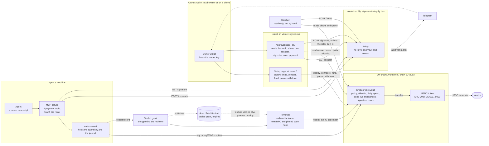
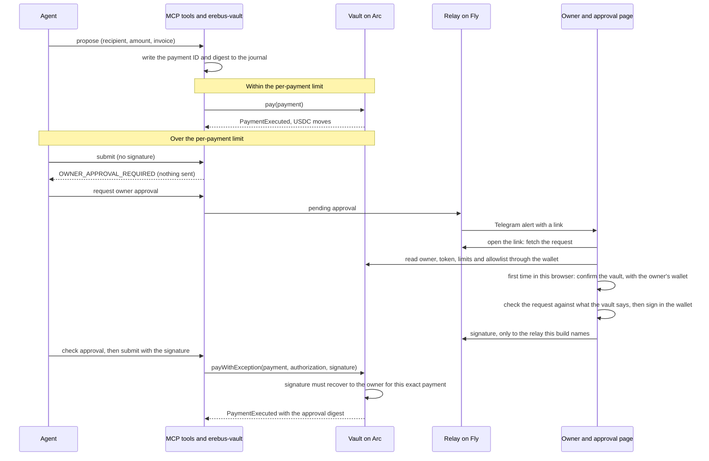

# Architecture

How the parts fit together, what each one is trusted for, and what lives on the chain. It describes version 1, which is what is deployed and has run on Arc testnet. Every part says what has actually been run. Nothing here is audited, and nothing is described as private except what is encrypted.

Updated 7 November 2026 from `STATUS.md`. Where this file and `STATUS.md` differ, `STATUS.md` is the record.

## The picture

Solid arrows are calls that exist in the code. Dotted arrows are optional or happen by hand. The last column of the table says what has actually been run, and where.

## An ordinary payment and an exception

No file is carried by hand on this path. The older route still exists: the owner downloads a config file from the setup page and loads it, with the request file, in a copy of the approval page that has no relay.

The vault runs every check itself. The tools, the relay and the pages can refuse, delay or mislead, but none of them can make a payment the vault would refuse.

## The parts

| Part | What it is | Holds | Trusted for | Not trusted for, and what a compromise can do | Run so far |
| --- | --- | --- | --- | --- | --- |
| **Owner** | A person with a wallet | The owner key, only in the wallet | Setting the rules, funding, signing exceptions, pausing, withdrawing | If the owner key is lost or stolen, the thief is the owner: the vault has no recovery and no way to change owner. **Whoever approves must hold the owner key**: someone at an organization cannot approve from their own wallet in version 1 | Signed in MetaMask on Arc |
| **Vault contract** (`contracts/evm/src/ErebusPolicyVault.sol`) | One vault per owner and agent. Immutable owner and token, not upgradeable | USDC, the policy, the allowlist, spend per day, used payment IDs and nonces | Enforcing every limit, the allowlist, expiry, replay protection, and that an exception is signed by the owner over the exact payment | It trusts the token to be a plain ERC-20 and the owner to be a plain account (no smart-contract wallets). The daily limit is the cap on unsigned spending, because splitting into small payments is allowed | Deployed on Arc from Arc Studio. Routine payments and owner-signed exceptions settled, and A1 to A4 reverted. Not audited |
| **USDC token** | Arc's ERC-20 view of native USDC, 6 decimals. The same balance is the native gas balance, with 18 decimals | The balances | Moving money when the vault calls `transfer` | The vault rejects any transfer that does not change the recipient's balance by exactly the amount | Used in every live run |
| **Hosting** (Vercel for the pages, Fly for the relay) | Where the pages and the relay run. One site holds the approval page at `/` and the setup page at `/setup/`, so they share what the owner has confirmed in a browser | The page code and the relay's state | Serving the pages and the relay | **A host that served different page code could mislead an owner,** since the page is the last check an owner reads. The wallet's own prompt and the vault's signature check still apply. The live site sends `X-Frame-Options: DENY`, a `frame-ancestors 'none'` Content-Security-Policy, `Referrer-Policy: no-referrer`, `X-Content-Type-Options: nosniff` and HSTS (checked from outside on 7 November). There is no wider Content-Security-Policy than `frame-ancestors`. MetaMask showed a phishing warning for the earlier address (`styx-approve.vercel.app`) on a Mac, and the reason is not known. It has not been re-checked on `styxco.xyz`. The relay accepts approvals only from `https://styxco.xyz`: the earlier address still serves pages, but the relay's CORS answer names only the new one | Live at `https://styxco.xyz` (setup at `/setup/`). A 2 USDC exception settled through the hosted pages and relay while they were still at the earlier address, before the move (`STATUS.md` records no approval through the new domain yet): [`0xde1c50dc...`](https://explorer.testnet.arc.io/tx/0xde1c50dc5d6312ea536319554e3008561f24a50fac2c7e2a822006a12a90b1a0) |
| **Setup page** (`setup-page/`) | The owner's page: deploy or connect a vault, set limits, vendors, fund, pause, withdraw, and set up approvals from alerts | Nothing. It never asks for a key | Showing the connected vault, warning before a second deploy, reading policy from the chain, and recording a vault for the approval page only when the wallet is its owner and its code matches the build | A page cannot be trusted to be the right one: the owner checks the vault address in its banner and the wallet's own prompt | 26 browser scenarios on a local chain, including the production build served under `/setup/`. An owner used an earlier version with MetaMask on Arc and hit four problems; the fixes have not been tried with a real wallet |
| **Approval page** (`owner-page/`) | Opens one request from an alert link, reads the owner, token, limits and allowlist from the vault, and signs the exact payment | Nothing. The browser keeps which vaults the owner has confirmed | Showing the recipient, amount and expiry in full, with vendor names only from the owner's own saved labels. Agent text is shown as text | The relay and the agent's text are not trusted: the page checks the request against the vault, and the vault checks the signature. A signature is bound to one vault, so one made for a look-alike vault cannot move funds from the real one | A real alert opened it on a phone wallet's browser, which read the owner and refused a wallet that is not the owner. **A signature by the owner on a phone is not shown.** The signature in MetaMask on a Mac is |
| **Agent** | A model or a script | Nothing but what its tools give it | Proposing and submitting payments | It is not trusted: it can be fooled by invoice text. It cannot change policy, sign an exception or withdraw. It holds only a gas-only key | A real model ran on a local chain (`mcp-server/examples/MODEL_TRIAL.md`). The real MCP tools ran against Arc |
| **MCP server** (`mcp-server/src/erebus_mcp/vault.py`) | Four tools: propose, submit, status and request approval, plus check approval when a relay is configured | Paths to files, and the relay token | Passing requests to `erebus-vault` and returning structured errors | It makes no policy decision. It refuses to start if an owner key variable is set, but cannot see a key under another name | Tests, a local chain, and live runs on Arc |
| **`erebus-vault`** (`sdk/evm/src/arc_vault/`) | The only program that signs and sends the agent's transactions | The agent key file and the journal | Writing the payment ID and digest to disk before it submits, and retrying under the same ID | It sends only what the vault will accept: a bug here could send wrong data but not bypass a rule | Tests, a local chain, and live runs on Arc |
| **Relay** (`relay/`, on Fly) | A small server that carries a pending request to the owner and a signature back | Pending files and signatures, on a volume. No keys | Delivering messages | It can withhold, delay or read pending files (amount, recipient, invoice reference). It cannot sign or make a payment go through. One relay serves one vault and one owner | A real Telegram bot delivered alerts, and the hosted relay carried a real exception |
| **Watcher** (`watcher/`) | A read-only process that alerts when the agent's call to the vault reverts, and when daily spend passes a threshold | A watcher token | Noticing, since a revert emits no event | It trusts its RPC and cannot stop anything. It is run by hand | Two Telegram notices reached the owner. **It is stopped now and not pointed at the hosted relay** |
| **Reviewer tools** (`erebus-disclosure`, the reviewer MCP server) | Open one sealed payment record and check it against the chain | The reviewer's key, and the vault code hash and issuer they pinned themselves | Reporting four results separately: record integrity, authorization, settlement, and the policy at execution. An unreachable chain reads "unavailable", never "unpaid" | It opens only the record sealed to that reviewer's key. It trusts the RPC the reviewer chooses | **G3 on a second Mac** with its own key and RPC, which also holds the repo and some unfunded test keys. A tampered copy and another record were refused, and an unreachable RPC read unavailable |
| **Arkiv** (`arkiv/`) | Publishes the sealed grant as an entity that expires | A publisher key, in its own environment | Storing ciphertext only | Anyone can write under its schema, so a reader filters by the writer address | **G4 passed on one machine:** one grant was published on Rabdi and fetched with no Styx process running. It ran on the issuer's Mac, not a separate reviewer's. The grant expires on 12 November 2026 |
| **Telegram** | Delivers the alert | Message text and a link | Telling the owner to look | The message proves nothing: it is built from fields the relay validated, and says so | A real bot, with real alerts |

## What is on-chain and what is off-chain

**On Arc, public to anyone:**
- The vault's code, its owner, token, agent, limits, expiry, allowlist and the policy version.
- Every payment: the amount, the recipient and the time, in `PaymentExecuted`, with the limits that were enforced, the policy version, the day's spend after the payment, whether it was an exception, and the owner's approval digest.
- A hash, `evidenceCommitment`, that commits to the invoice without revealing it.
- Reverted attempts, as transactions. A revert emits no event, which is why the watcher reads transactions.

**Off-chain:**
- The invoice itself, and the salt that opens its commitment. They are in the sealed record only.
- The pending approval request (amount, recipient, the agent's invoice reference) and the signature, on the relay and in the agent's vault directory.
- **On Arkiv:** only the sealed record's ciphertext, which one reviewer's key opens.
- The keys, each in its own place: the owner key in a wallet, the agent key in a file read by `erebus-vault`, the issuer and reviewer keys in their own files, the Telegram and watcher tokens in the relay's and watcher's environments.
- In the owner's browser: which vaults the owner has confirmed for approvals, and the vendor names the owner typed. Neither is on-chain.

**Encrypted:** only the sealed payment record. Payments themselves are not private: amount, recipient and timing are public on Arc.

## Who can do what

| | Change policy | Allow vendors | Pay within limits | Pay over the per-payment limit | Pause | Withdraw |
| --- | --- | --- | --- | --- | --- | --- |
| Owner | Yes | Yes | No, only the agent calls `pay` | Signs the exception | Yes | Yes |
| Agent | No | No | Yes | Only with the owner's signature over that exact payment | No | No |
| Reviewer | No | No | No | No | No | No. Opens one record |
| Relay, watcher, pages | No | No | No | No | No | No |

The daily limit always applies, even to an exception. Because the per-payment limit does not add up across payments, the daily limit is the most the agent can pay in a day without a signature.

## What version 1 does not have

- **One agent per vault, and one owner key.** Approver roles, several agents with separate limits, and a multisig owner are not built. The approver must hold the owner key.
- Smart-contract wallets as owners, shielding or private payments, other chains or tokens, and key management or recovery for the agent.
- A signature by the owner on a phone.
- An independent audit. The contract needs its own human review before it holds anything that matters.
